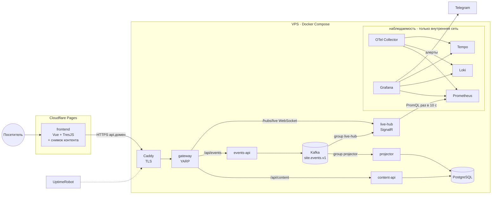
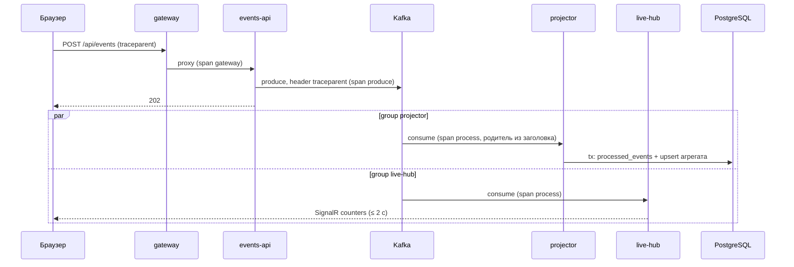

# Технический дизайн: сайт-портфолио MVP

Статус: accepted · Дата: 2026-10-20
Спека: docs/spec/portfolio-mvp.md · План: docs/plans/roadmap.md · Решения: docs/adr/0001…0006

Документ отвечает на вопрос «чем и как». Что делаем и как проверяем — в спеке; порядок работ — в планах этапов.

## 1. Архитектурные драйверы
1. **Сайт = доказательство навыков (G4).** Kafka, SignalR, OpenTelemetry и несколько сервисов — осознанный
   драйвер «показать навык», а не нагрузки. Нагрузка ничтожная: десятки–сотни визитов в день.
2. **Первые 30 секунд (G1, T1, T3).** Первый экран — чистый HTML ≤ 150 КБ JS gzip; 3D грузится после отрисовки
   и никогда не блокирует контент.
3. **Независимость фронта от бэкенда (NFR4).** Сайт должен работать, даже если упал весь VPS: статика на CDN
   + вшитый снимок контента. Бэкенд — улучшение, а не зависимость.
4. **Один разработчик, ≈ 16 дней, один VPS 8 ГБ (NFR8).** Никаких управляемых облаков и Kubernetes;
   минимум движущихся частей на сервис.
5. **Приватность без баннера (NFR6).** Без cookies, без IP в хранилищах, без сторонней аналитики.

**Самый простой вариант** — один ASP.NET-сервис с PostgreSQL, без брокера, без отдельного gateway — закрывает
все функциональные требования, кроме доказательства стека. Он отвергнут из-за драйвера 1 и оставлен как
запасной путь: при срыве срока projector и live-hub сливаются в один процесс (ADR-0002) — с изоляцией
двух BackgroundService, иначе нарушается NFR4.

## 2. Стек
Версии — минимальные; в этапе 1 фиксируются актуальные стабильные (проверить через context7) в
`global.json`, `Directory.Packages.props` и `package.json`.

| Слой | Технология | Зачем |
|---|---|---|
| Фронт | Vue 3 + TypeScript + Vite | План; лёгкий рантайм, SFC, хорошая связка с TresJS |
| 3D | TresJS + cientos (поверх three.js) | Декларативная сцена в Vue-компонентах (ADR-0005) |
| Состояние | Pinia | Активная остановка, открытое окно, тема, язык, поворот, режим 2D/3D |
| i18n | vue-i18n | EN/RU, ленивые словари |
| Предрендер | vite-ssg | Текст глав в HTML для SEO и без JS (FR11) |
| Валидация контента | JSON Schema + Ajv (скрипт сборки) | AC7: падение сборки на `[ADD]` и `#` |
| Живые данные | @microsoft/signalr (ленивый импорт) | Клиент live-hub, грузится только при открытии Monitoring |
| Web Vitals | web-vitals | LCP/INP/CLS → событие `web_vital` |
| Тесты фронта | Vitest, Playwright, @axe-core/playwright, Lighthouse CI, size-limit | TC-01…TC-11, T1–T5 |
| Бэкенд | .NET 10, ASP.NET Core Minimal APIs | План; LTS |
| Gateway | YARP + встроенный RateLimiter + CORS | Единая точка входа (FR13, NFR7) |
| Данные | PostgreSQL + EF Core (Npgsql) | content-api и projector |
| Журнал | Apache Kafka (KRaft, 1 брокер) + Confluent.Kafka | Событийный журнал (ADR-0002) |
| Реалтайм | ASP.NET Core SignalR | live-hub → браузер |
| Локальный запуск | .NET Aspire AppHost | Одна команда поднимает всё (AC13) |
| Общее | Aspire ServiceDefaults | OTel, health checks, resilience (Polly через Microsoft.Extensions.Http.Resilience) |
| Тесты .NET | xUnit, Testcontainers (Kafka, PostgreSQL), WebApplicationFactory | TC-12…TC-15 |
| Наблюдаемость | OpenTelemetry SDK → OTel Collector → Prometheus / Loki / Tempo → Grafana | FR15, NFR5 |
| Прод | Docker Compose, Caddy (TLS), Cloudflare Pages (фронт) | ADR-0006 |
| CI/CD | GitHub Actions, GHCR | FR16 |

## 3. Компоненты



| Компонент | Ответственность | Владеет данными |
|---|---|---|
| frontend | Рендер первого экрана, окон, сцены; отправка событий; показ живых метрик | Снимок контента в бандле |
| gateway | Маршрутизация, TLS-за-Caddy, rate limit, CORS, фильтр ботов, начало серверного трейса | — |
| content-api | Отдаёт контент глав EN/RU с кэшем и ETag | Схема `content` в PostgreSQL |
| events-api | Принимает, валидирует и обезличивает события, пишет в Kafka | — (пишет в журнал) |
| projector | Читает журнал, строит агрегаты идемпотентно | Схема `stats` в PostgreSQL |
| live-hub | Читает журнал, держит онлайн и счётчики в памяти, опрашивает Prometheus, пушит по SignalR | Только память |
| Kafka | Единственный источник правды о событиях; позволяет пересчитать агрегаты | Топик `site.events.v1` |
| OTel-стек + Grafana | Метрики, логи, трейсы, дашборды, алерты | Тома Prometheus/Loki/Tempo |

## 4. Фронтенд

### Модули (ADR-0007; опирается на ADR-0003, ADR-0004)
Одна предметная область — одна папка `src/<module>/` с публичным `index.ts`; чужой модуль — только через него,
стрелки только вниз, циклов нет. Граф — `frontend/scripts/module-graph.mjs` (из него ESLint строит границы),
таблица «модуль → может импортировать» — `frontend/CLAUDE.md`.
```
frontend/src/
  main.ts      вход vite-ssg: App из ./app, i18n и маршруты из ./locale, глобальные стили темы
  app/         оболочка: тонкий App.vue (композиция модулей и раскладка), TopBar, useLayout, head
  shared/lib/  storage (load/save в localStorage), useBreakpoint
  shared/ui/   базовые компоненты: BaseButton, IconButton, Icon + реестр иконок, Dialog (фокус-ловушка), StatusPill, ChapterTag, MetricCard
  content/     типы контента, бандлы EN/RU, главы и маршрут, расчёт стажа из дат, форматирование
  theme/       palette.ts — единый объект палитры → CSS-переменные + цвета материалов/света/воды; стор темы, boot
  locale/      vue-i18n (en.json / ru.json — только строки интерфейса), маршруты `/` и `/ru/`, стор языка
  route/       стор маршрута (остановки, активная, посещённые), нижняя панель, RouteBar, RouteStop
  hero/        HeroCard и его размещение
  chapters/    8 окон глав и блоки, реестр; без import() — окна в main-чанке и предрендере
  windows/     WindowHost, каркас ChapterWindow, история окна (pushState/hashchange), предрендер глав
  fallback2d/  статичная 2D-карта (render.ts, StaticMap)
  scene/       ленивый чанк TresJS: Island, Roads, Water, Truck, buildings/<Key>.vue; index.ts — точка import()
  mode/        режим 2D/3D: shouldUse3D, стор режима, загрузчик сцены, SceneHost, баннер отката
  telemetry/   (этап 4) events.ts (fetch keepalive), traceparent.ts, vitals.ts — модуль без зависимостей от UI
```
Живые метрики окна Monitoring (SignalR) — ленивый модуль по образцу `scene`: `index.ts` грузит чанк через `import()`.

### Загрузка и производительность
1. HTML предрендерен (vite-ssg) для двух маршрутов: `/` (EN) и `/ru/` (RU) — hero, нижняя панель и
   текст всех глав на своём языке; страницы связаны взаимными `hreflang` и `x-default` → `/` (FR11).
   Картинка-заглушка карты (webp, `fetchpriority=high`) — LCP-элемент.
   Язык: при первом визите без сохранённого выбора и с RU-языком браузера клиент один раз переходит на `/ru/`
   (до гидрации, инлайн-скрипт в `<head>`); переключатель меняет маршрут без перезагрузки и запоминает выбор
   в `localStorage`. Перерисовки EN → RU после загрузки нет.
2. Гидрация основного бандла (Vue, Pinia, i18n, диалоги) — бюджет ≤ 150 КБ gzip, контроль size-limit.
3. Сразу после монтирования (плюс `<link rel="modulepreload">` чанка сцены из boot-скрипта при ширине ≥ 768 и WebGL2 — T12b, 2026-10-24; раньше — после `requestIdleCallback`) и только если `shouldUse3D()` — `import('./scene')` (three + TresJS +
   геометрия, бюджет ≤ 2 МБ). Сцена плавно заменяет заглушку; метка `performance.mark('scene_ready')` (T2).
4. `shouldUse3D()`: есть WebGL2, `deviceMemory ≥ 4` (если известно), ширина ≥ 768, пользователь не выбрал 2D.
   Иначе остаётся 2D-режим (FR10).
5. SignalR-клиент импортируется только при открытии окна Monitoring.

### Навигация и грузовик (закрывает D5)
- Клик по остановке сразу открывает окно (≤ 600 мс, AC3); грузовик едет фоном к остановке. Клик во время
  езды перенаправляет маршрут, а не игнорируется.
- Путь — массив путевых точек по дорогам; движение в `useLoop` (TresJS), курс через `atan2`. При
  `prefers-reduced-motion` — телепорт.
- Поворот карты — поворот камеры вокруг центра шагом 90°, анимация 300 мс (или мгновенно).

### Окна
- Один компонент `Dialog` (native `<dialog>` + `showModal()`): ловушка фокуса, Esc, возврат фокуса, `aria-labelledby`.
- Общий каркас окна + акцент главы (D-пункты дизайн-ревью). Окна (`chapters`) получают бандл пропсом, навигацию — через стор `route`.
- Состояние окна отражается в URL-хэше (`#prospace`) — ссылку на главу можно отправить, назад работает.

### Темы
`palette.ts` экспортирует `{ day, evening, night }`: токены интерфейса (фон, текст, акцент, рамка) и
параметры сцены (небо, вода, солнце, цвет материалов). Плагин применяет токены как CSS-переменные на `:root`,
сцена читает тот же объект реактивно. Контраст пар текст/фон проверяется юнит-тестом (≥ 4,5:1).

### Телеметрия из браузера
- `sessionId` — случайный UUID в `sessionStorage` (живёт до закрытия вкладки; не cookie). Сервер его
  дополнительно хэширует с суточной солью (§5.3).
- `visit`, `stop_opened`, `skill_opened`, `cta_click` уходят **сразу**, по одному событию на запрос —
  `fetch(url, { method: 'POST', keepalive: true, headers: { 'Content-Type': 'application/json', traceparent } })`.
  `keepalive` доставляет запрос и при уходе со страницы (клик по Telegram). Батчем (до 20, раз в 10 с и на
  `visibilitychange`) уходят только `web_vital`. `sendBeacon` не используем: он не ставит заголовки
  (`traceparent`) и шлёт cookies.
- Бюджет задержки T9 (≤ 2 с от клика до окна Monitoring): браузер → events-api ≈ 100–300 мс, produce ≤ 50 мс,
  live-hub consume ≤ 100 мс, троттлинг рассылки ≤ 1 с, SignalR ≈ 50 мс — итого ≤ 1,5 с.
- `eventId` — UUIDv7, генерируется в браузере → основа идемпотентности.
- Каждый запрос несёт заголовок `traceparent`, сгенерированный вручную (≈ 30 строк, без OTel Web SDK — он
  не влезает в бюджет). Так трейс начинается в браузере (NFR5): одно бизнес-событие = один запрос = один трейс.
- `?src=` читается при первом визите и кладётся в `visit.source` (M4).

## 5. Бэкенд

### 5.1 Общее для всех сервисов
- Minimal APIs, `AddServiceDefaults()`: OTel (трейсы, метрики, логи), `/health` (готовность, с проверкой
  зависимостей) и `/alive` (жив ли процесс), resilience для исходящих HTTP.
- Конфигурация — только переменные окружения; локально их выставляет AppHost, в проде — `.env` Compose.
- Логи — структурные (JSON) в stdout → Collector → Loki; `TraceId` в каждой записи.
- Ошибки — `ProblemDetails` (RFC 9457); необработанные исключения → 500 без деталей наружу.
- Graceful shutdown: consumer коммитит офсет и закрывается по `StopAsync`.
- Каждый сервис — свой Dockerfile (chiseled-образ .NET), non-root.
- Раскладка кода сервиса (слои `Api/Application/Domain/Infrastructure/Workers`, порты, `BuildingBlocks`) — ADR-0008.

### 5.2 gateway
| Маршрут | Куда | Политики |
|---|---|---|
| `GET /api/content/{lang}` | content-api | кэш браузера по ETag (`api.` не проксируется через CDN) |
| `POST /api/events` | events-api | rate limit 60 событий/мин на клиента, тело ≤ 16 КБ |
| `/hubs/live` (WebSocket) | live-hub | ≤ 3 соединения на клиента |
| `POST /api/messages` | events-api | 3 записки в час на клиента, тело ≤ 4 КБ (FR17) |
| `/health` | агрегат health всех сервисов | только для smoke в CD и внутренних алертов |
| `/alive` | сам gateway | для внешнего uptime-пинга (T7) |

Клиент для лимитов — IP посетителя. `api.` указывает прямо на VPS (DNS-only, без прокси Cloudflare). Caddy
без `trusted_proxies` игнорирует входящий `X-Forwarded-For` и ставит реальный адрес клиента; gateway
доверяет `ForwardedHeaders` только от контейнера Caddy (`KnownProxies`, `ForwardLimit = 1`), поэтому подставить
адрес нельзя. IP используется только в памяти лимитера, не логируется (в логах — маска /24).
CORS: только домены сайта; разрешены методы `GET, POST` и заголовки `Content-Type, traceparent`. Фильтр ботов: известные User-Agent ботов → события 204 без
записи. Начинает серверный span, продолжая `traceparent` браузера.

### 5.3 events-api
- `POST /api/events` — одно событие или массив до 20 (массив — только `web_vital`). Валидация по схеме
  из `Contracts` (тип, размеры, допустимые поля payload по типу). Невалидный запрос → 400 целиком (TC-15).
- Обезличивание: `sessionHash = HMAC-SHA256(sessionId, dailySalt)`. Соль — случайная, генерируется на сутки,
  хранится только в памяти сервиса (рестарт = новая соль, это допустимо). IP и User-Agent в событие не попадают;
  из UA сохраняется только класс устройства (desktop / mobile).
- Producer: `acks=all`, `enable.idempotence=true`, ключ — `sessionHash` (порядок событий сессии сохраняется).
  Заголовки сообщения: `traceparent`, `schema-version`.
- Если Kafka недоступна дольше таймаута (2 с) → 503; фронт событие выбрасывает (аналитика best effort,
  сайт от этого не страдает). Outbox не нужен: у events-api нет своей БД, единственная запись — в журнал.
- Ответ — 202 Accepted.
- **Записки (FR17):** `POST /api/messages` `{name ≤ 80, replyTo ≤ 120, text ≤ 2000, website}` (`website` —
  honeypot: заполнен → 204 без отправки). Валидация → отправка через Telegram Bot API (`sendMessage` в чат
  владельца; токен и chat id из env) типизированным HttpClient с resilience-хендлером (таймаут 5 с, 2 ретрая).
  Успех → 202; Telegram недоступен → 503, фронт предлагает написать в Telegram напрямую. Тело записки не
  пишется в логи, трейсы (только длины) и Kafka; в журнал уходит только `cta_click{cta: bottle}`. Записки не в
  Kafka осознанно: это не аналитика, а доставка, и хранить личные данные негде и незачем.

### 5.4 Контракт события `site.events.v1`
```json
{
  "eventId": "0192f5c4-…",            // UUIDv7 из браузера, ключ идемпотентности
  "type": "visit | stop_opened | skill_opened | cta_click | web_vital",
  "occurredAt": "2026-10-20T12:00:00Z", // время браузера; сервер ставит receivedAt
  "receivedAt": "2026-10-20T12:00:01Z",
  "sessionHash": "base64url…",
  "lang": "en | ru",
  "theme": "day | evening | night",
  "device": "desktop | mobile",
  "payload": { }                        // по типу: visit{source}, stop_opened{stop}, skill_opened{skill},
                                        // cta_click{cta: contact|cv|telegram|github|hh|email|bottle}, web_vital{name,value}
}
```
Источник истины по полям и допустимым значениям (включая лимиты payload и правила валидации) — код
`src/Contracts/Events` (`SiteEvent`, `IncomingEvent`, `EventTypes.cs`, `EventValidator`); пример выше — иллюстрация.
Допустимые значения закрыты, чтобы агрегаты и live-счётчики не росли от произвольного ввода: `stop` ∈ id глав
контента (ключи `chapters` в `content/*.json`: profile, prospace, timepath, techstack, education, contact, summary,
monitoring); `skill` — имя технологии: 1–64 символа из букв, цифр, пробела и `. + # / _ -`, без пробелов по краям;
управляющие символы и непарные суррогаты запрещены во всех строковых полях. Снимок списков — `tests/Contracts.Tests/AllowedValuesTests`.
Сериализация — JSON (System.Text.Json, source generators). Эволюция: только добавление необязательных полей;
несовместимое изменение → новый топик `site.events.v2`. Schema Registry не используем — один продюсер, схемы
в общем проекте `Contracts` (ADR-0002).

Топик: 3 партиции, replication 1 (один брокер), retention 365 дней (объём < 1 ГБ в год при текущем трафике) —
этого хватает, чтобы пересчитать агрегаты с нуля.

### 5.5 projector
- Consumer group `projector`, `enable.auto.commit=false`, `auto.offset.reset=earliest`.
- Обработка батчами до 200 сообщений: в **одной транзакции** PostgreSQL — `INSERT INTO stats.processed_events
  (event_id) ON CONFLICT DO NOTHING`, и только для новых событий — `UPSERT` агрегатов. После коммита
  транзакции — коммит офсета. Повторная доставка ⇒ ON CONFLICT ⇒ агрегат не меняется (TC-12).
- Трейсинг: на каждое сообщение — дочерний span `process site.events.v1` от `traceparent` из его заголовка
  (так событие остаётся в своём трейсе); span транзакции батча связан с ними через span links.
- Таблицы `stats`: `daily_visits(day, source, device, visits)`, `stop_opens(day, stop, n)`,
  `cta_clicks(day, cta, source, n)`, `web_vitals(day, name, p75 …)` (p75 считается из гистограммы-бакетов),
  `processed_events(event_id pk, processed_at)` с очисткой старше 30 дней.
- Ядовитое сообщение (не десериализуется) → лог + метрика `events_poison_total`, офсет двигается дальше
  (DLQ для MVP избыточна).
- Пересчёт: `projector --rebuild` — очищает `stats`, сбрасывает офсеты группы на начало.

### 5.6 live-hub
- Consumer group `live-hub`, `auto.offset.reset=latest`, автокоммит (потеря пары событий при рестарте не важна).
- В памяти: онлайн = уникальные `sessionHash` за последние 5 мин; счётчик событий за сегодня; лента
  агрегатов по типам. Восстановление после рестарта — из самого журнала: при старте live-hub через
  `OffsetsForTimes(начало суток UTC)` перематывает партиции и перечитывает сегодняшние события
  (сотни–тысячи сообщений, секунды). БД у live-hub нет.
- Раз в 10 с — PromQL-запросы в Prometheus (rpm, p95, доля 5xx, consumer lag, uptime) → кэш.
- SignalR-хаб `/hubs/live`: при подключении — снапшот; далее `metrics` раз в 10 с и `counters` не чаще раза в
  секунду (троттлинг). Один инстанс → backplane не нужен.
- Только агрегаты, без ленты действий (решение по спеке).

### 5.7 content-api
- Источник правды — `/content/{en,ru}.json` в репозитории (ADR-0004). При старте сервис валидирует их той же
  схемой и делает upsert в `content.bundles(lang, version_hash, json, updated_at)`, если хэш изменился.
- `GET /api/content/{lang}` → весь бандл языка (≈ 20–40 КБ) с `ETag = version_hash`, output cache 10 мин,
  `304` на `If-None-Match`.
- Версия бандла — монотонная `contentVersion` (время коммита контента, UTC), плюс `version_hash`. Фронт
  рендерит вшитый снимок и подменяет его ответом API, **только если** `contentVersion` в API строго больше.
  Поэтому откат VPS на старый тег не возвращает посетителям старый текст, а при совпадении версий нет ни
  подмены, ни сдвига вёрстки.
- Миграции EF Core — отдельной задачей, применяются при деплое отдельной командой (`migrate`), не на старте.
- Драйвер навыка назван явно: EF Core, кэширование, ETag. Без этого драйвера content-api был бы лишним —
  фронту хватило бы снимка.

### 5.8 PostgreSQL
Один инстанс, две базы данных `content` и `stats` (Aspire `AddPostgres().AddDatabase(...)`), в каждой — своя схема того же
имени и своя таблица истории миграций. Сервисы получают только свою connection string и не читают чужую базу.
Отдельные роли `content_rw`/`stats_rw` отложены до этапа 6 (compose), если понадобятся для прод-инстанса (решение в T8).

## 6. Сквозной путь клика (NFR5, TC-12)

Confluent.Kafka не создаёт спаны сам: инъекция и извлечение `traceparent` — через
`Propagators.DefaultTextMapPropagator` в обёртке в `ServiceDefaults` (один код для продюсера и обоих
консьюмеров). Это и есть «spike» E4-T0.

## 7. Наблюдаемость
- **Сбор.** Все сервисы → OTLP → Collector (единственная точка экспорта). Collector: метрики → Prometheus
  (remote write; Prometheus запускается с `--web.enable-remote-write-receiver`), логи → Loki, трейсы → Tempo.
  Сэмплинг трейсов 100% (трафик мал).
- **Живость снаружи процессов.** При push-модели метрики `up` для сервисов нет, а метрики упавшего процесса
  просто пропадают. Поэтому Prometheus сам опрашивает: blackbox-exporter → `/alive` каждого сервиса
  (`probe_success`) и kafka-exporter → лаг consumer group (`kafka_consumergroup_lag`). Лаг меряется вне
  консьюмера, поэтому виден и когда projector лежит.
- **Метрики.** RED из ASP.NET Core-инструментации; `kafka_consumergroup_lag` (kafka-exporter); `signalr_connections`; бизнес-счётчики `site_events_total{type}`;
  Web Vitals — гистограммы из projector.
- **Дашборды и алерты как код:** `deploy/grafana/provisioning/` (JSON дашбордов, alert rules, contact point
  Telegram — токен бота из `.env`). Правила: `probe_success == 0` 2 мин (любой сервис); доля 5xx > 2% за 5 мин;
  `kafka_consumergroup_lag > 50` 10 мин (при сотнях событий в день 50 — уже явная остановка); диск > 80%;
  для правил на пропадающих рядах — «No data → Alerting».
- **Наружу** не открыты Prometheus, Loki, Tempo, Grafana — доступ владельца через SSH-туннель.
- **Публичное окно Monitoring** получает данные только из live-hub (§5.6).
- **Внешний пинг** UptimeRobot: фронт (`https://домен/`) — это и есть T7, и `https://api.домен/alive`
  (gateway). Сводный `/health` в uptime не участвует: падение projector не должно засчитываться простоем сайта.

## 8. Инфраструктура и деплой (ADR-0006)
- **Фронт:** Cloudflare Pages, сборка из CI (`npm run build` → `wrangler pages deploy`) — CDN и TLS бесплатно.
  Основной домен → Pages, `api.` → VPS.
- **VPS:** Docker Compose (`deploy/compose.yaml`), написан руками, а не сгенерирован Aspire — прозрачнее для
  читателя репо. Caddy держит TLS для `api.домен`, наружу открыты только 80/443 и SSH (по ключу).
- **Бюджет памяти (лимиты контейнеров):**

  | Контейнер | Лимит |
  |---|---|
  | Kafka (KRaft, heap 512 МБ) | 1 ГБ |
  | PostgreSQL | 512 МБ |
  | 5 сервисов .NET × 256 МБ | 1,25 ГБ |
  | Prometheus / Loki / Tempo | 1 ГБ / 512 МБ / 512 МБ |
  | Grafana / Collector / Caddy | 256 / 256 / 128 МБ |
  | blackbox-exporter / kafka-exporter | 32 / 64 МБ |
  | **Итого** | **≈ 5,6 ГБ** из 8 (запас под ОС и пики, T10 < 7 ГБ) |

- **CD:** тег `v*` → build + test → образы `ghcr.io/pollezha/aboutme-<svc>:<tag>` → SSH `docker compose pull
  && docker compose up -d` → smoke `/health`. Откат — `deploy/rollback.sh <prev-tag>` (переписывает `TAG`
  в `.env` и повторяет up). Миграции БД — отдельный шаг перед `up` и только вперёд-совместимые.
- **Бэкапы:** ночной `pg_dump` → объектное хранилище; Kafka не бэкапим (агрегаты восстанавливаются из БД,
  а журнал за год — приемлемая потеря при гибели диска).
- **Секреты:** GitHub Secrets (SSH-ключ, токен Cloudflare) и `.env` на сервере (пароли БД, токен бота
  Telegram). В репо — только `.env.example`.

## 9. Локальная разработка
- `dotnet run --project src/AppHost` поднимает PostgreSQL, Kafka, 5 сервисов и фронт (Vite dev-сервер через
  JavaScript-хостинг Aspire — точное API пакета проверить в этапе 1 через context7); дашборд Aspire
  показывает логи, трейсы и метрики без Grafana. Требования к машине: Docker, .NET 10 SDK, Node.js LTS.
- Фронт можно запускать отдельно: `npm run dev` — работает на снимке контента без бэкенда (этап 3).
- Grafana-стек локально — опциональный профиль Compose `observability`.

## 10. Сквозные вопросы — чек-лист
| Вопрос | Решение |
|---|---|
| Идемпотентность, повторная доставка | eventId из браузера; projector — `processed_events` в той же транзакции; producer idempotent |
| Транзакционные границы, outbox | events-api: одна запись в Kafka, outbox не нужен; projector: агрегат + отметка в одной транзакции, офсет после коммита |
| Ошибки внешних систем | Kafka недоступна → 503, событие теряется (best effort); content-api недоступен → фронт на снимке; Prometheus недоступен → Monitoring показывает «нет данных», последние значения с отметкой времени |
| Таймауты, ретраи, CB | Исходящий HTTP — стандартный resilience-хендлер (ретраи с jitter, таймаут, circuit breaker); producer — встроенные ретраи librdkafka с `delivery.timeout.ms=2000` |
| Аутентификация | Публичный API без аутентификации; защита — rate limit, размер тела, валидация схемы, CORS. Админки нет |
| Секреты | Только env / GitHub Secrets; хук проекта блокирует правку `.env*` агентом |
| Наблюдаемость | §7; correlation = TraceId во всех логах |
| Health checks | `/alive` — процесс; `/health` — зависимости (БД, Kafka) |
| Миграции и совместимость | EF-миграции отдельным шагом; события — только аддитивно, иначе новый топик; API контента версионируется полем `schemaVersion` в бандле |
| Стоимость | VPS €10–36/мес + домен ≈ €1/мес + бэкап ≈ €1/мес; остальное бесплатно |
| Приватность | Без cookies; sessionId в sessionStorage + HMAC с суточной солью; IP только в памяти лимитера |

## 11. Что сознательно не делаем в MVP
Schema Registry и Avro/Protobuf, DLQ, outbox, backplane SignalR, Kubernetes, OTel Web SDK, CMS/админка,
несколько брокеров Kafka. Сигнал вернуться к каждому — в соответствующем ADR.
